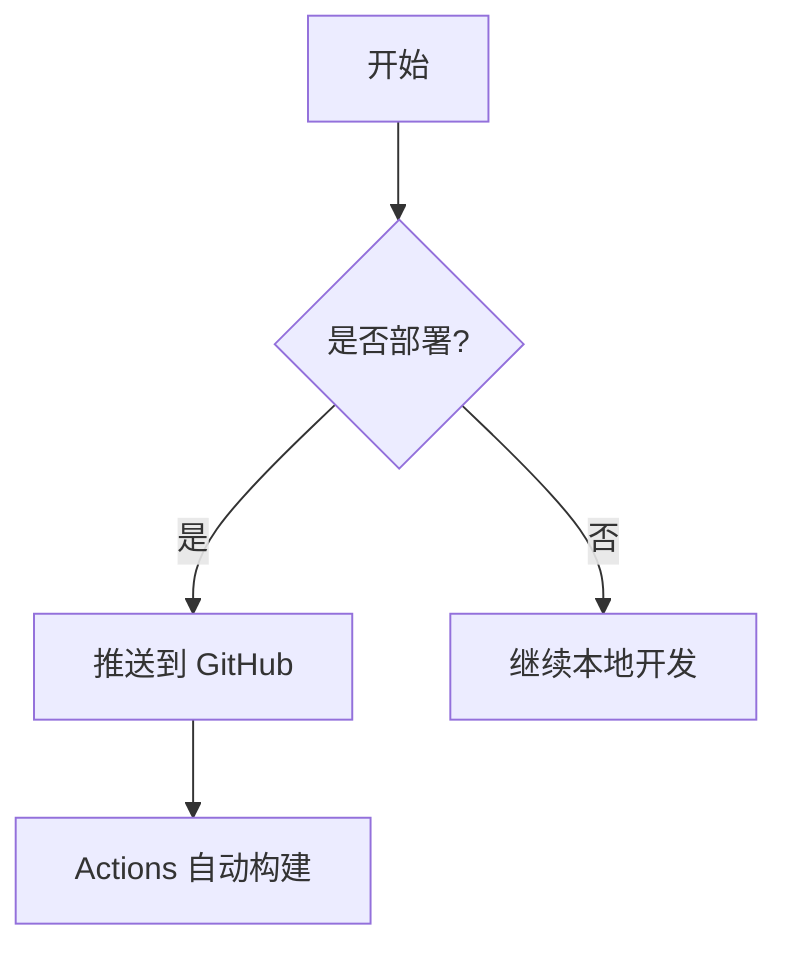
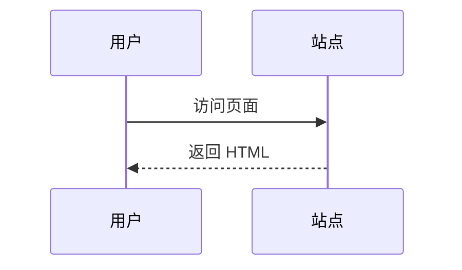

import Tabs from '@theme/Tabs';
import TabItem from '@theme/TabItem';

# 组件演示

这一篇把内容里**能用的组件**全部列出来，写文章时照抄即可。每个组件的语法见代码块说明。

## 一、标题

```md
# 一级标题
## 二级标题
### 三级标题
#### 四级标题
```

实际渲染效果：

### 三级标题示例

#### 四级标题示例

## 二、文本与链接

**加粗**、*斜体*、~~删除线~~、`行内代码`，以及 [站内链接](/kb) 和 [外链](https://github.com)。

```md
**加粗**、*斜体*、~~删除线~~、`行内代码`、[链接](/kb)
```

## 三、列表

### 无序列表

- 第一项
- 第二项
  - 嵌套子项
- 第三项

### 有序列表

1. 第一步
2. 第二步
3. 第三步

### 任务列表

- [x] 已完成
- [ ] 待办

## 四、代码块

### 带标题

```jsx title="src/components/Hello.js"
export default function Hello() {
  return <div>你好，世界</div>;
}
```

### 行高亮

```python {2,4}
def greet(name):
    print("Hello")          # 高亮这一行
    print("World")
    print(name)             # 也高亮这一行
```

### 行号

```bash showLineNumbers
sudo apt update
sudo apt install git
```

## 五、表格

| 阶段 | 主题 | 状态 |
| --- | --- | --- |
| 入门 | 环境准备 | 完成 |
| 开发 | 二次开发 | 进行中 |
| 运维 | 部署监控 | 待补充 |

## 六、引用块

> 记录真实的开发过程、项目选择、经验总结和开源工具实践。

## 七、提示框

::::note[备注]
普通备注信息，蓝色。
::::

::::tip[提示]
有用的建议，绿色。
::::

::::info[信息]
补充说明，天蓝色。
::::

::::caution[注意]
需要留意，橙色。
::::

::::warning[警告]
务必注意，橙色。
::::

::::danger[危险]
高风险操作，红色。
::::

## 八、图片


## 九、分割线

---

## 十、折叠块

<details>
  <summary>点击展开详情</summary>

这里是折叠起来的内容，适合放补充说明或长日志。

</details>

## 十一、标签页 Tabs

<Tabs>
  <TabItem value="npm" label="npm" default>

```bash
npm install
```

  </TabItem>
  <TabItem value="pnpm" label="pnpm">

```bash
pnpm install
```

  </TabItem>
  <TabItem value="yarn" label="yarn">

```bash
yarn install
```

  </TabItem>
</Tabs>

## 十二、Mermaid 图



### 时序图



## 十三、数学公式（KaTeX）

行内公式：质能方程 $E = mc^2$。

块级公式：

$$
\int_{-\infty}^{\infty} e^{-x^2} \, dx = \sqrt{\pi}
$$

## 十四、代码 Diff

```diff
- const oldValue = 1;
+ const newValue = 2;
```

## 十五、脚注

这里引用了一个脚注[^1]。

[^1]: 这是脚注的内容，会显示在文末。
