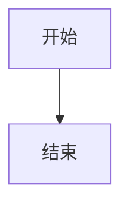

# 写作指南

这一篇告诉你**以后怎么写文章**。先看整体流程，再逐条看细节。

## 一、文件放哪

```
docs/                    ← 知识库文章（.md 或 .mdx）
├── erpnext/
│   ├── _category_.json  ← 这个分类的名字/顺序
│   ├── index.mdx        ← 分类的「目录页」（可省略）
│   └── install.mdx      ← 一篇具体文章
├── wordpress/
├── devops/
└── guide/               ← 你现在看的这个分类

blog/                    ← 博客文章
└── 2026-10-18-标题/index.mdx

static/                  ← 图片等静态资源，放 /img/xxx.png
```

**知识库文章 → `docs/<分类>/<文件名>.mdx`，博客文章 → `blog/<日期>-<标题>/index.mdx`。**

## 二、一篇文章的样子（front matter）

每篇文章开头用 `---` 包起来的一段元信息：

```md
---
title: 环境准备
description: 安装前的系统依赖与版本确认
sidebar_position: 1
---

正文从这里开始…
```

| 字段 | 作用 | 是否必填 |
| --- | --- | --- |
| `title` | 文章标题（也是侧边栏显示名） | 建议写 |
| `description` | 摘要，用于 SEO 和列表页 | 建议写 |
| `sidebar_position` | 在侧边栏里的顺序（数字越小越靠前） | 可选 |
| `featured: true` | 博客置顶为精选（仅博客） | 可选 |
| `tags` / `authors` | 博客标签/作者 | 博客用 |

## 三、怎么分类（新增一个主题）

1. 在 `docs/` 下建一个文件夹，例如 `docker/`；
2. 里面放一个 `_category_.json`：

```json
{
  "label": "Docker",
  "position": 1
}
```

3. 往里放 `.mdx` 文章。

保存提交后，**知识库首页会自动出现「Docker」卡片**，侧边栏也会自动分组，不用改任何代码。

## 四、常用 Markdown

```md
# 一级标题（文章里用一次）
## 二级标题
### 三级标题

**加粗** *斜体* ~~删除线~~ `行内代码`

- 无序列表
1. 有序列表
- [x] 任务列表

[链接文字](/kb)  

| 表格 | 列 |
| --- | --- |
| 值 | 值 |

> 引用块
```

## 五、MDX 组件（进阶）

> 完整示例见 [组件演示](/about/components)，这里只讲「怎么用」。

### 提示框（四冒号写法）

```md
::::tip[标题]
内容
::::
```

类型有 `note / tip / info / caution / warning / danger` 六种。

### 代码块

```md
```jsx title="文件名.js" showLineNumbers
// 代码
```
```

### 代码 Diff

```md
```diff
- 删除的行
+ 新增的行
```
```

### 标签页 Tabs

```mdx
import Tabs from '@theme/Tabs';
import TabItem from '@theme/TabItem';

<Tabs>
  <TabItem value="a" label="甲" default>内容甲</TabItem>
  <TabItem value="b" label="乙">内容乙</TabItem>
</Tabs>
```

### Mermaid 图

```md

```

### 数学公式

行内 `$E = mc^2$`，块级用 `$$ … $$` 包起来。

### 脚注

```md
文字[^1]

[^1]: 脚注内容
```

### 折叠块

```md
<details>
  <summary>点我展开</summary>
  隐藏内容
</details>
```

## 六、博客怎么写

```md
---
title: 文章标题
authors: yyj
tags: [部署, 排错]
featured: true   ← 置顶精选（可选）
---

正文…
```

`blog/authors.yml` 里定义作者，`blog/tags.yml` 里定义标签。

## 七、本地预览与发布

```bash
cd ~/sites/my-website
npm start          # 本地热更新 http://192.168.1.102:3001/YYJ-wiki/
```

改完提交推上去，GitHub Actions 自动构建发布，约 2 分钟上线：

```bash
git add .
git commit -m "写一篇新文章"
git push
```

> 注意：搜索索引只在**生产构建**里生效，本地 `npm start` 搜不到是正常的，用 `npm run build && npm run serve` 验证搜索。

## 八、可选功能（需要时再开）

### 文档版本化

```bash
npm run docusaurus docs:version 1.0.0
```

会把当前 `docs/` 冻结成 `versioned_docs/version-1.0.0`，右上角出现版本切换。内容稳定后再考虑。

### 多语言

在 `docusaurus.config.js` 的 `i18n` 里加 `locales: ['zh-Hans', 'en']`，再执行 `docusaurus write-translations` 生成英文翻译文件。

### 评论（Giscus）

看 `src/components/ui/Giscus.jsx` 里的说明：开启仓库 Discussions → 到 giscus.app 拿两个 id 填进去即可。

### 访问统计

装 `@docusaurus/plugin-google-gtag`，在配置里填入 Google Analytics 的 tracking ID。需要先在 analytics.google.com 建一个数据流拿到 ID。

## 九、写文章要遵守的几条

1. 一篇文章一个主题，标题用「做什么」而不是「标题党」；
2. 正文多用小标题分段，长段落拆开；
3. 代码块写清 `title`，命令写清在哪台机器执行；
4. 图片放 `static/img/`，用相对路径 `/img/xxx.png` 引用；
5. 改完本地 `npm start` 看一眼再提交。
